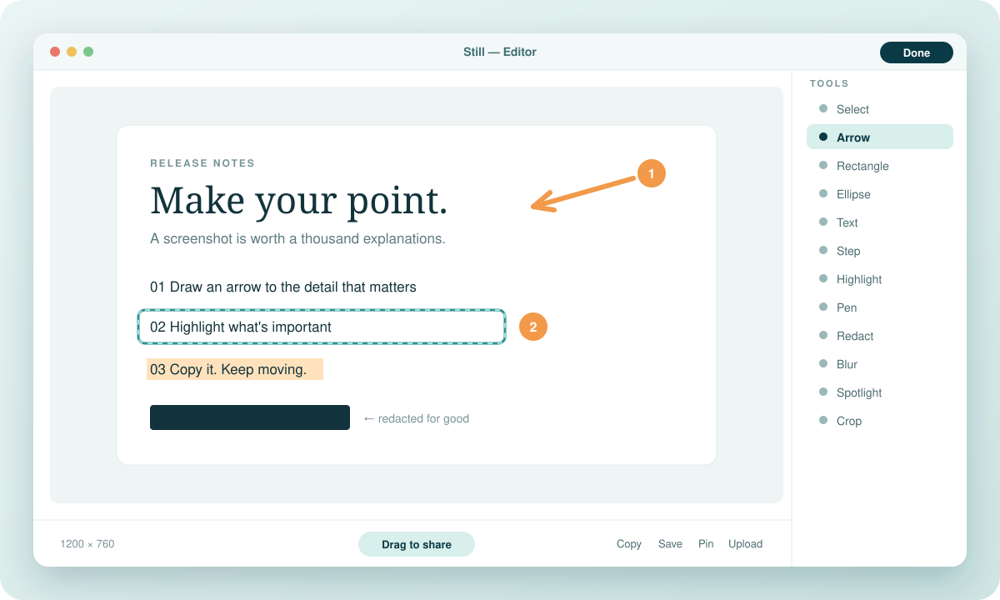

<p align="center">
  
</p>

<p align="center">
  <a href="#macos"></a>&nbsp;
  <a href="#windows"></a>&nbsp;
  <a href="#linux"></a>
</p>

<p align="center">
  <a href="https://github.com/ImSammyTTV/Still/releases/latest"></a>
  <a href="https://github.com/ImSammyTTV/Still/releases"></a>
  
</p>

<br>

**Still** sits in your menu bar until you need it. Press a shortcut, grab an area or a window, mark it up and
send it on — usually in a few seconds, and without opening a single window you didn't ask for.

> **Capture** with `⇧⌘4` (hold `Space` for a window) &nbsp;→&nbsp; **mark it up** with arrows, steps and redaction
> &nbsp;→&nbsp; **share**: it's already on your clipboard.

<p align="center">
  
</p>

## What you get

| | |
|---|---|
| **Capture anything** <br> Drag over an area or hold `Space` and click a window. Full screen, timers, exact sizes and aspect-ratio lock live in the **Capture Bar** at the bottom of the screen. Open menus and Spotlight stay in the shot. | **A preview that waits for you** <br> Every capture lands in a small Floating Preview, already copied. Copy, save, edit, pin or upload from it, or drag it straight into a chat, an email or a document. |
| **Mark it up** <br> Arrows, boxes, lines, pen, highlighter, text, numbered steps, spotlight, blur, pixelate and solid redaction. Every mark stays editable, with full undo. | **Make it presentable** <br> Backgrounds, padding, rounded corners, shadows and aspect ratios for posts, then **Drag to share** or save. |
| **Copy text from anything** <br> Select text in an image, a video or an app that won't let you copy. Recognition runs on your computer. | **Record your screen** <br> An area or the whole screen, with microphone and computer audio. On Mac: GIF export, a camera bubble, click and keystroke overlays and a video editor. |
| **Clipboard history** (Mac) <br> `⇧⌘V` brings back anything you copied lately — text, images or files. Passwords marked private are skipped. | **Private by design** <br> No account, no tracking. Captures stay on your computer; sharing only happens when you press **Upload** to your own server. |

## Install

### macOS

```sh
curl -fsSL https://raw.githubusercontent.com/ImSammyTTV/Still/main/install-mac.sh | sh
```

Paste that into **Terminal**. It downloads the latest release, checks it against the published checksums, installs
**Still.app** in Applications and opens it. Apple silicon and Intel, macOS 15 or later.

On your first capture, switch Still on under **System Settings → Privacy & Security → Screen & System Audio Recording**
(the upper list). Still lives in the menu bar, not the Dock.

<details>
<summary>Install from the zip instead</summary>

1. Download `Still-…-mac-universal.zip` from the [latest release](https://github.com/ImSammyTTV/Still/releases/latest), unzip it and move **Still.app** to Applications.
2. Open it. When macOS says it can't check it, click **Done**.
3. Go to **System Settings → Privacy & Security**, scroll down and click **Open Anyway**.
</details>

### Windows

Download **`Still_…_x64-setup.exe`** from the [latest release](https://github.com/ImSammyTTV/Still/releases/latest)
(`…_arm64-setup.exe` on ARM PCs, or the `portable.exe` if you'd rather not install). It's about 9 MB.
If Windows shows *"Windows protected your PC"*, click **More info → Run anyway**.

### Linux

Use the `.AppImage` on any distro, the `.deb` on Ubuntu, Debian, Mint and Pop!_OS, or the `.rpm` on Fedora and openSUSE.
Needs Ubuntu 24.04, Fedora 40, Debian 13 or newer. Picking a window with `Space` needs X11; on Wayland Still uses your
desktop's screen-sharing prompt. If global shortcuts aren't allowed, bind your own to `still --capture=area`
(or `window`, `fullscreen`, `text`, `record`, `allInOne`, `history`).

Updates install themselves on Windows and Linux. On Mac, choose **Check for Updates…** in the menu bar menu.

## Shortcuts

| | Mac | Windows & Linux |
|---|---|---|
| Capture an area (hold `Space` for a window) | `⇧⌘4` | `Ctrl Shift 4` |
| Open the Capture Bar | `⌃⇧⌘S` | `Ctrl Shift 5` |
| Capture a window | `⌃⇧⌘4` | `Ctrl Alt Shift 4` |
| Capture the whole screen | `⌃⇧⌘5` | `Ctrl Shift 3` |
| Copy text from the screen | set in Settings | `Ctrl Shift 2` |
| Start or stop recording | `⌃⇧⌘6` | `Ctrl Shift 6` |
| Clipboard history | `⇧⌘V` | — |

While selecting: `Shift` keeps it square, arrow keys nudge (`Shift` for 10 px, `Option`/`Alt` to resize), `Enter`
captures, `Esc` cancels. In the editor each tool has a letter: `A` arrow, `R` rectangle, `T` text, `N` step, `B` redact,
`U` blur, `C` crop and so on. Change any shortcut in **Settings → Shortcuts**.

> [!NOTE]
> macOS uses `⇧⌘4` for its own screenshots. If Still asks, turn off *"Save picture of selected area as a file"* in
> **System Settings → Keyboard → Keyboard Shortcuts → Screenshots**.

## Sharing links

Run your own **Still Cloud** server — one Python file in [`Cloud/`](Cloud/README.md), no dependencies — and connect to
it in **Settings → Cloud**. Press **Upload** anywhere in Still and the link is copied. Links can expire, stay within your
team or be private, and the viewer supports comments.

## Questions

<details>
<summary><b>Screen capture doesn't work on my Mac</b></summary>

Open **System Settings → Privacy & Security → Screen & System Audio Recording** and make sure Still is on in the
**upper** list (the *System Audio Recording Only* list below it doesn't allow screenshots). If it's missing, click **+**,
choose `/Applications/Still.app` and reopen Still. Still not working? **Settings → General → Open Setup Assistant →
Check Again**, and keep only one copy of Still in Applications.
</details>

<details>
<summary><b>A shortcut doesn't do anything</b></summary>

Another app may own it. Still marks taken shortcuts in red under **Settings → Shortcuts**; click one and press a new
combination.
</details>

<details>
<summary><b>Is blur safe for hiding passwords?</b></summary>

Use **Redact** (`B`), which paints solid colour over the pixels. Blur and pixelate are for looks and can sometimes be
reversed. Share the exported image, not the editable project.
</details>

<details>
<summary><b>Where are my captures?</b></summary>

Mac: `~/Library/Application Support/Still` · Windows: `%AppData%\app.still.desktop` ·
Linux: `~/.local/share/app.still.desktop` (settings in `~/.config/app.still.desktop`).
Every capture keeps its original, so you can reopen it from **Capture History** and change it later.
</details>

Found a bug or have an idea? [Open an issue](https://github.com/ImSammyTTV/Still/issues/new).

## Building Still

<details>
<summary><b>Mac</b> — Swift, AppKit, SwiftUI, ScreenCaptureKit</summary>

```sh
swift test
./scripts/build.sh        # universal Still.app next to the project folder
```
</details>

<details>
<summary><b>Windows and Linux</b> — Tauri (Rust in <code>Desktop/src-tauri</code>, pages in <code>Desktop/web</code>)</summary>

Needs Node.js 20+ and Rust; Linux also needs the WebKitGTK and PipeWire packages listed in
[`release.yml`](.github/workflows/release.yml).

```sh
cd Desktop
npm install
npm test                  # JavaScript and Rust tests
npm start                 # run from source
npm run build             # installers in src-tauri/target/release/bundle
```

`still --self-test=<folder>` checks capture, the preview, copying, the editor, text recognition and sharing; CI runs it
on real Windows and Linux machines.
</details>

<details>
<summary><b>Releases and signing</b></summary>

**Actions → Release → Run workflow** with a version such as `v1.3.0` builds and publishes every download. Mac builds
are signed with the project's own certificate (not notarized, hence **Open Anyway** on first launch); Windows builds
aren't code-signed yet; Windows and Linux updates are verified against the project's signing key. Still only contacts
GitHub to check for updates, and your own Still Cloud server when you upload.
</details>

See [FEATURES.md](FEATURES.md) for what's built on each platform.

<br>

<p align="center"><sub>Made by <a href="https://github.com/ImSammyTTV">ImSammyTTV</a></sub></p>
