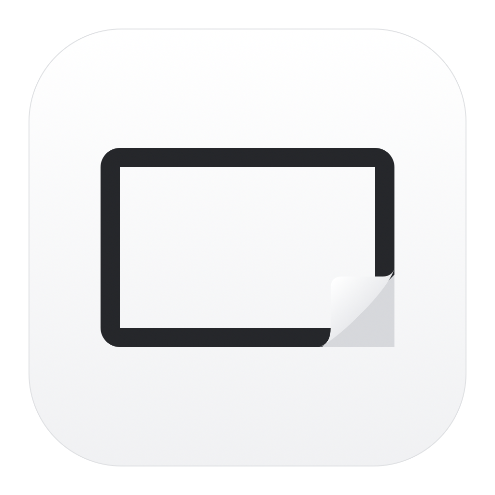
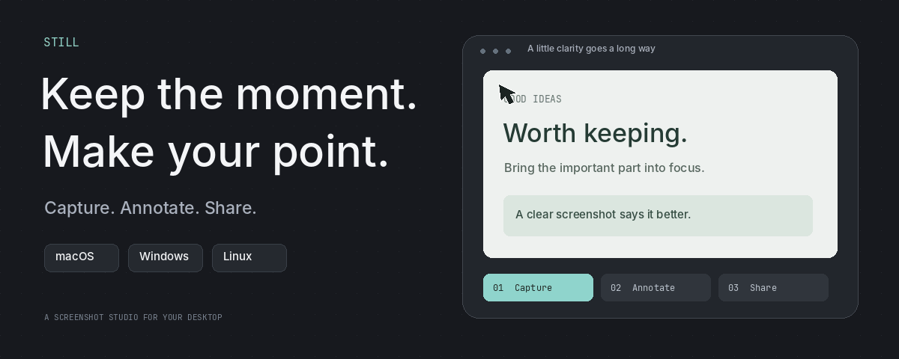

<p align="center">
  
</p>

<h1 align="center">Still</h1>
<p align="center"><strong>A screenshot is only the beginning.</strong><br>Capture a moment, make your point, and keep moving.</p>

<p align="center">
  <a href="https://github.com/ImSammyTTV/Still/releases/latest"></a>
  <a href="https://github.com/ImSammyTTV/Still/releases/latest"></a>
  <a href="https://github.com/ImSammyTTV/Still/releases/latest"></a>
</p>

<p align="center">
  <a href="https://github.com/ImSammyTTV/Still/releases/latest"></a>
  <a href="https://github.com/ImSammyTTV/Still/actions/workflows/ci.yml"></a>
  
</p>

<p align="center">
  <a href="#what-you-can-do">Features</a> ·
  <a href="#install">Install</a> ·
  <a href="#your-first-capture">First capture</a> ·
  <a href="#shortcuts">Shortcuts</a> ·
  <a href="#help">Help</a> ·
  <a href="#privacy">Privacy</a>
</p>

<picture>
  <source media="(prefers-reduced-motion: reduce)" srcset="assets/readme/capture-workflow.png">
  
</picture>

Still sits quietly in your menu bar or system tray. Press a shortcut, grab what you need, mark it up, and it's already
on your clipboard.

<a id="what-you-can-do"></a>
## What you can do

<table>
<tr>
<td width="33%" valign="top">

### 📸 Capture
- An area, a window or the whole screen
- A long page with scrolling capture
- A timer, so menus can be open
- Exact sizes and aspect ratios
- Text from any picture, on your computer

</td>
<td width="33%" valign="top">

### ✏️ Make it clear
- Arrows, text, shapes and numbered steps
- Highlight, spotlight and magnify
- Redact or blur private details, or let Still find them
- Backgrounds, padding, corners and shadows
- Your own text or logo as a watermark

</td>
<td width="33%" valign="top">

### 🚀 Keep moving
- Copied to your clipboard straight away
- A floating preview with quick actions
- Pin captures above your other windows
- History of everything you've captured
- **Save for Size:** a square, a width and a file size limit

</td>
</tr>
<tr>
<td colspan="3" valign="top">

### 🎬 Record and edit video
Record your screen with sound and your camera, then trim, cut, speed up the slow parts, zoom in, add text, blur
and music, and export a video or GIF.

</td>
</tr>
</table>

**Extra on Mac:** clipboard history and image actions in Finder's right-click menu.

> [!NOTE]
> A few features depend on your system. [FEATURES.md](FEATURES.md) lists what works where.

<a id="install"></a>
## Install

**[Open the latest release →](https://github.com/ImSammyTTV/Still/releases/latest)** and pick the file for your computer:

| Your computer | Download this |
| :--- | :--- |
| 🍎 **Mac** (macOS 15 or later, Apple silicon or Intel) | `Still-…-mac-universal.zip` |
| 🪟 **Windows** (most PCs) | `Still_…_x64-setup.exe` |
| 🪟 **Windows** on an ARM PC | `Still_…_arm64-setup.exe` |
| 🐧 **Linux** | `.AppImage` (any distro), `.deb` (Ubuntu, Debian) or `.rpm` (Fedora) |

Still updates itself, so you only need to do this once.

<details>
<summary><strong>🍎 Mac: step by step</strong></summary>

1. Open the ZIP and drag **Still** into **Applications**.
2. Open Still. It appears in the menu bar, not the Dock.
3. If macOS says it can't check the app, open **System Settings → Privacy & Security** and choose **Open Anyway**.
4. When asked, turn Still on under **Screen & System Audio Recording** (the top list, not "System Audio Recording
   Only").

Prefer the terminal? This installer checks the download for you:

```sh
curl -fsSL https://raw.githubusercontent.com/ImSammyTTV/Still/main/install-mac.sh -o install-still.sh
less install-still.sh
sh install-still.sh
```

</details>

<details>
<summary><strong>🪟 Windows: step by step</strong></summary>

1. Run the setup file you downloaded.
2. Windows may show **"Windows protected your PC"**, because Still isn't code-signed. Choose **More info**, then
   **Run anyway**.
3. Still appears in the system tray (the arrow near the clock).

A portable `.exe` that needs no installing is in every release too.

</details>

<details>
<summary><strong>🐧 Linux: step by step</strong></summary>

- **AppImage:** right-click the file → Properties → allow running as a program, then open it.
- **Ubuntu / Debian:** open the `.deb` file to install it.
- **Fedora:** open the `.rpm` file to install it.

On Wayland, your desktop asks before each capture. If shortcuts don't work there, add one in your desktop's keyboard
settings that runs `still --capture=area` (or `window`, `fullscreen`, `text`, `record`, `allInOne`, `history`).

</details>

<a id="your-first-capture"></a>
## Your first capture

| | |
| :---: | :--- |
| **1** | **Open Still.** A short setup guide walks you through it. |
| **2** | **Allow screen capture** when asked. Camera and microphone are optional. |
| **3** | **Press the capture shortcut** (below) and drag over what you want. Hold **Space** to pick a window instead. |
| **4** | **Paste it anywhere.** It's already copied. Or use the preview that pops up to annotate, save, pin or share. |

Saved files go to **Documents/Still** unless you choose another folder in Settings.

<a id="shortcuts"></a>
## Shortcuts

| Action | 🍎 Mac | 🪟 Windows / 🐧 Linux |
| :--- | :---: | :---: |
| Capture an area | `⇧⌘4` | `Ctrl Shift 4` |
| Open the Capture Bar | `⌃⇧⌘S` | `Ctrl Shift 5` |
| Capture a window | `⌃⇧⌘4` | `Ctrl Alt Shift 4` |
| Capture the whole screen | `⌃⇧⌘5` | `Ctrl Shift 3` |
| Start / stop recording | `⌃⇧⌘6` | `Ctrl Shift 6` |
| Clipboard history | `⇧⌘V` | — |

**While selecting:** hold **Space** for a window · **Enter** captures · **Esc** cancels · arrow keys nudge (hold
**Shift** for bigger steps) · scroll to zoom the magnifier · **T** sets a timer.

Change any shortcut in **Settings → Shortcuts**. On Mac, `⇧⌘4` belongs to the built-in screenshot tool until you turn
it off in **System Settings → Keyboard → Keyboard Shortcuts → Screenshots**.

<a id="help"></a>
## Help

<details>
<summary><strong>Screen capture is turned on, but capturing still fails (Mac)</strong></summary>

Make sure there's only one copy of Still in Applications, reopen it, and run the check in the setup guide (**Settings
→ General → Open Setup Assistant**).

</details>

<details>
<summary><strong>Is blur safe for passwords and personal details?</strong></summary>

Use **Redact** for anything private: it replaces the pixels for good. Blur and pixelate only soften them. Share an
exported picture rather than an editable project, which keeps the original.

</details>

<details>
<summary><strong>Where are my captures kept?</strong></summary>

Your History lives here, separate from the pictures you save to **Documents/Still**. Updating Still keeps it.

| | |
| :--- | :--- |
| 🍎 Mac | `~/Library/Application Support/Still` |
| 🪟 Windows | `%AppData%\app.still.desktop` |
| 🐧 Linux | `~/.local/share/app.still.desktop` |

</details>

<details>
<summary><strong>How do I update?</strong></summary>

Still checks for updates on its own. To check now: **Check for Updates** in the menu bar (Mac) or **Settings → About**
(Windows, Linux).

</details>

Something not right? **[Report a bug](https://github.com/ImSammyTTV/Still/issues/new)** and tell us your system, what
you expected and what happened.

<a id="privacy"></a>
## Privacy

🔒 Your screenshots and recordings stay on your computer. Still goes online only to check for updates, and, if you use
Describe Image with your own key, to send that one picture to the AI service you chose.

Every download is built from this repository's public source code by its
[release workflow](.github/workflows/release.yml), and each release lists the files' checksums in `SHA256SUMS`.

<details>
<summary><strong>🛠️ For developers</strong></summary>

**Mac app** (Swift, needs Xcode with the macOS 15 SDK):

```sh
swift test
./scripts/build.sh
```

Keep development builds apart from the installed app: a different signing identity can reset screen permissions.

**Windows and Linux app** (Tauri; needs Node.js 20+, Rust and the dependencies in
[the release workflow](.github/workflows/release.yml)):

```sh
cd Desktop
npm ci
npm test
npm start
```

Design notes: [docs/DESIGN-SYSTEM.md](docs/DESIGN-SYSTEM.md) and [docs/BRAND.md](docs/BRAND.md). Releases are published
through **Actions → Release → Run workflow** with a version such as `v1.2.60`. The README animation is made by
`scripts/readme-artwork.py`.

</details>

---

<p align="center">Free and open source under the <a href="LICENSE">MIT License</a> · Made by <a href="https://github.com/ImSammyTTV">ImSammyTTV</a> · <a href="https://github.com/ImSammyTTV/Still/releases">Release history</a></p>
