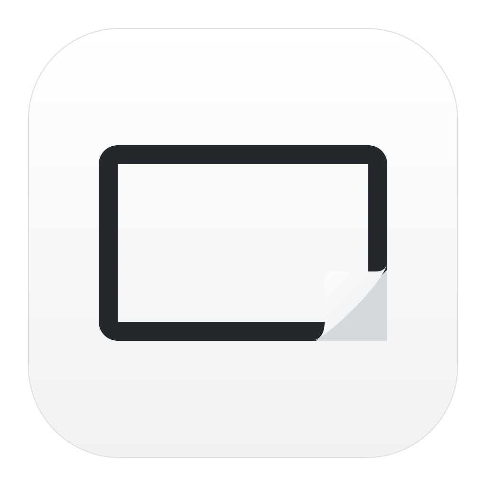

<p align="center">
  
</p>

<h1 align="center">Still</h1>

<p align="center">
  <strong>Take a screenshot. Point out what matters. Share it in seconds.</strong><br>
  A small, free screenshot and screen-recording app for Mac, Windows and Linux.
</p>

<p align="center">
  <a href="https://github.com/ImSammyTTV/Still/releases/latest"></a>
  <a href="https://github.com/ImSammyTTV/Still/actions/workflows/ci.yml"></a>
  
</p>

<p align="center">
  <a href="#download">Download</a> ·
  <a href="#what-you-can-do">What you can do</a> ·
  <a href="#getting-started">Getting started</a> ·
  <a href="#keyboard-shortcuts">Shortcuts</a> ·
  <a href="#sharing-and-privacy">Sharing &amp; privacy</a> ·
  <a href="#questions-and-fixes">Help</a> ·
  <a href="#for-developers">For developers</a>
</p>

<picture>
  <source media="(prefers-reduced-motion: reduce)" srcset="assets/readme/capture-workflow.png">
  
</picture>

## What is Still?

Still sits quietly in your menu bar (Mac) or system tray (Windows and Linux) until you need it. Press a shortcut, pick the part of the screen you want, and the picture is on your clipboard before you let go of the mouse. A small preview appears in the corner so you can draw on it, save it, pin it to the screen, or upload it to your own sharing server.

It is built for the everyday moments: showing a teammate where the bug is, saving a receipt, keeping a chart from a meeting, or pulling the text out of an image you can't copy from.

- **Free and open source.** No account, no subscription, no tracking.
- **Private by default.** Your screenshots stay on your computer unless you choose to upload them.
- **Native on every platform.** The Mac app is written for the Mac. The Windows and Linux app is a lightweight desktop app that shares one codebase.

## Download

**[Get the latest version →](https://github.com/ImSammyTTV/Still/releases/latest)**

| Your computer | Download this file |
| :--- | :--- |
| **Mac** (macOS 15 or newer) | `Still-…-mac-universal.zip` (works on Apple silicon and Intel) |
| **Windows** | `Still_…_x64-setup.exe` for most PCs, or `Still_…_arm64-setup.exe` for ARM PCs |
| **Linux** | `.AppImage` (runs anywhere), `.deb` (Debian, Ubuntu) or `.rpm` (Fedora and similar) |

Not sure which Windows file you need? Pick **x64**. There are also portable Windows versions that run without installing anything.

Every release ships with a `SHA256SUMS` file so you can check the download was not tampered with. See [Getting started](#getting-started) for platform-specific install notes.

## What you can do

<table>
  <tr>
    <td width="33%" valign="top">
      <h3>📸 Capture</h3>
      <ul>
        <li>Grab a selected area, a single window, or a whole screen</li>
        <li>Set a timer so menus and pop-ups stay open</li>
        <li>Type an exact size or lock the aspect ratio</li>
        <li>Copy text straight out of anything on screen</li>
        <li>Record your screen as a video</li>
      </ul>
    </td>
    <td width="33%" valign="top">
      <h3>✏️ Make your point</h3>
      <ul>
        <li>Arrows, boxes, circles, lines and freehand pen</li>
        <li>Text labels and numbered steps</li>
        <li>Highlighter and spotlight to draw the eye</li>
        <li>Blur, pixelate or solidly black out private details</li>
        <li>Add a background, padding, rounded corners and a shadow</li>
        <li>Undo, redo, and come back to edit later</li>
      </ul>
    </td>
    <td width="33%" valign="top">
      <h3>🚀 Keep moving</h3>
      <ul>
        <li>Copied to your clipboard automatically</li>
        <li>A floating preview with one-click actions</li>
        <li>Pin a capture so it floats above other windows</li>
        <li>Browse, search and reopen everything you've captured</li>
        <li>Upload to a sharing server you control</li>
      </ul>
    </td>
  </tr>
</table>

**Extra on Mac:** scrolling capture for long pages, clipboard history, a video editor with trimming and zoom, GIF export, a camera bubble for recordings, click and keystroke overlays, QR code reading, and right-click actions on images in Finder.

> [!NOTE]
> Not everything is available on every platform yet, and some features have had more testing than others. [FEATURES.md](FEATURES.md) has the full checklist, feature by feature, for Mac and for Windows/Linux.

## Getting started

1. **Install Still and open it.** A short setup assistant walks you through the first run.
2. **Allow screen capture when your system asks.** Camera, microphone and cloud setup are optional and can be skipped.
3. **Take your first capture.** Pick **Capture Area** from the Still menu, then drag over part of the screen. Hold **Space** to switch to picking a window, or press **Escape** to cancel.
4. **Use it.** The capture is already on your clipboard, so you can paste it anywhere. The floating preview lets you draw on it, save it, pin it or upload it.

Saved images go to **Documents/Still** unless you choose another folder in Settings. Still also keeps its own editable copy of every capture in **Capture History**, so you can go back and change annotations later.

<details>
<summary><strong>Installing on Mac</strong></summary>

<br>

Unzip the download, drag **Still.app** into your **Applications** folder, and open it. Still appears in the menu bar at the top of the screen rather than in the Dock.

**If macOS says the app can't be opened:** Still is signed with the project's own certificate rather than one from Apple, so the first launch may be blocked. Open **System Settings → Privacy & Security**, scroll down to the notice about Still, and choose **Open Anyway**.

**Screen permission:** when asked, turn on **Still** in the **Screen & System Audio Recording** list (the upper one). The separate "System Audio Recording Only" list does not allow screenshots. You can rerun the guide any time from **Settings → General → Open Setup Assistant**.

**Prefer the Terminal?** This installer downloads the latest release, checks its checksum and signature, and installs it for you:

```sh
curl -fsSL https://raw.githubusercontent.com/ImSammyTTV/Still/main/install-mac.sh -o install-still.sh
less install-still.sh
sh install-still.sh
```

</details>

<details>
<summary><strong>Installing on Windows</strong></summary>

<br>

Run the installer. Choose **x64** for most PCs, or **ARM64** if you have an ARM-based laptop such as a Snapdragon device. Still uses the Edge web engine that is already part of Windows, so there is nothing else to install.

**If Windows shows a blue "protected your PC" warning:** Still is not yet signed with a Windows publisher certificate. Click **More info**, then **Run anyway**. If you want to double-check the file first, compare it against the `SHA256SUMS` file on the release page.

</details>

<details>
<summary><strong>Installing on Linux</strong></summary>

<br>

- **AppImage:** mark the file as executable (right-click → Properties, or `chmod +x`), then run it.
- **Debian or Ubuntu:** install the `.deb` package.
- **Fedora and other RPM-based systems:** install the `.rpm` package.

Still is built on Ubuntu 24.04 and needs a recent WebKitGTK and your desktop's screen-sharing support. On Wayland, capture goes through your desktop's screen-sharing dialog.

If your desktop does not allow apps to register global shortcuts, you can bind a desktop shortcut to one of these commands instead:

```sh
still --capture=area
```

Other options are `window`, `fullscreen`, `text`, `record`, `allInOne` (the Capture Bar) and `history`.

</details>

## Keyboard shortcuts

These are the defaults. You can change any of them in **Settings → Shortcuts**.

| What it does | Mac | Windows / Linux |
| :--- | :--- | :--- |
| Capture an area | `⇧ ⌘ 4` | `Ctrl Shift 4` |
| Capture a window | `⌃ ⇧ ⌘ 4` | `Ctrl Alt Shift 4` |
| Capture the whole screen | `⌃ ⇧ ⌘ 5` | `Ctrl Shift 3` |
| Open the Capture Bar | `⌃ ⇧ ⌘ S` | `Ctrl Shift 5` |
| Copy text from the screen | — | `Ctrl Shift 2` |
| Start or stop recording | `⌃ ⇧ ⌘ 6` | `Ctrl Shift 6` |
| Clipboard history | `⇧ ⌘ V` | — |

**While selecting an area:** hold **Space** to pick a window instead, press **Enter** to confirm, or **Escape** to cancel. The arrow keys nudge the selection by a pixel, and **Shift** plus an arrow key moves it further.

> [!TIP]
> On a Mac, `⇧⌘4` normally belongs to the built-in screenshot tool. To give it to Still, open **System Settings → Keyboard → Keyboard Shortcuts → Screenshots** and turn off "Save picture of selected area as a file". Or just pick a different shortcut in Still.

## Sharing and privacy

Still never sends anything anywhere on its own. Screenshots, recordings and recognised text all stay on your computer.

If you want to share captures by link, Still comes with **Still Cloud**: a small sharing server you run yourself, on your own machine or on a server you rent. You get share links with optional passwords, expiry dates and view limits, comments on images and videos, and team accounts. Because you host it, you decide where your files live.

- **Set it up:** follow the [Still Cloud guide](Cloud/README.md).
- **Connect the app:** go to **Settings → Cloud**, paste your server address and token, then use **Upload** on any capture.

Uploads include any text Still recognised in the image and any transcript from a recording, so your server can search them. Automatic uploading after every capture is off by default and is a separate setting you can switch on.

## Questions and fixes

<details>
<summary><strong>I allowed screen access, but capture still doesn't work (Mac)</strong></summary>

<br>

Make sure only one copy of Still is installed, in the Applications folder, then quit and reopen it. Rerun the check in the setup assistant. macOS ties the permission to the app's signature, so a different build of Still (for example one you compiled yourself) can show as allowed while actually being blocked. Updates from the release page keep the same signature, so they keep working.

</details>

<details>
<summary><strong>Is blur enough to hide private information?</strong></summary>

<br>

No. Blur and pixelate are visual effects and can sometimes be reversed. Use the **Redact** tool, which paints solid black over the area and removes those pixels from the exported image. One more thing to know: Still's editable project files keep the original picture underneath so you can change your edits later, so share the exported image rather than the project file.

</details>

<details>
<summary><strong>Where does Still keep my captures?</strong></summary>

<br>

Exported images go to **Documents/Still** by default. The editable originals that power Capture History live in the app's own data folder:

| System | Folder |
| :--- | :--- |
| Mac | `~/Library/Application Support/Still` |
| Windows | `%AppData%\app.still.desktop` |
| Linux | `~/.local/share/app.still.desktop` and `~/.config/app.still.desktop` |

Updating Still keeps your capture library intact.

</details>

<details>
<summary><strong>How do I update?</strong></summary>

<br>

On Mac, choose **Check for Updates** from the Still menu. On Windows and Linux, open **Settings → About**. Still downloads the update, checks its signature, and relaunches.

</details>

<details>
<summary><strong>Something else is wrong</strong></summary>

<br>

**[Open an issue](https://github.com/ImSammyTTV/Still/issues/new)** and include your operating system, what you expected to happen, and what happened instead. Screenshots help, naturally.

</details>

## For developers

Still is three projects in one repository:

| Folder | What it is | Built with |
| :--- | :--- | :--- |
| `Sources/` | The Mac app | Swift, SwiftUI and AppKit |
| `Desktop/` | The Windows and Linux app | Tauri (Rust) with a plain HTML and JavaScript interface |
| `Cloud/` | The optional sharing server | Python, standard library only |

<details>
<summary><strong>Mac app</strong></summary>

<br>

You need Xcode with the macOS 15 SDK.

```sh
swift test
```

```sh
./scripts/build.sh
```

Keep your own builds separate from the installed release. Because macOS ties the screen-capture permission to the app's signature, installing a locally signed build over the release can make macOS forget that permission. Maintainers can use the **Mac Preview** workflow together with `scripts/install-mac.sh` to install a build that keeps the release signature.

</details>

<details>
<summary><strong>Windows and Linux app</strong></summary>

<br>

You need Node.js 20 or newer, a Rust toolchain, and on Linux the system libraries listed in [the release workflow](.github/workflows/release.yml).

```sh
cd Desktop
```

```sh
npm ci
```

```sh
npm test
```

```sh
npm start
```

```sh
npm run build
```

`npm start` opens the app in development mode. The app also has a built-in self-test, `still --self-test=<folder>`, which the CI runs on real Windows and Linux machines.

</details>

<details>
<summary><strong>Sharing server</strong></summary>

<br>

The server needs Python 3.10 or newer and nothing else.

```sh
python3 -m unittest discover -s Cloud/tests -v
```

The [Still Cloud guide](Cloud/README.md) covers running it locally, hosting it behind HTTPS with the included Docker setup, and every configuration option.

</details>

<details>
<summary><strong>Releases</strong></summary>

<br>

Maintainers publish from **Actions → Release → Run workflow** with a version number such as `v1.2.7`. The workflow builds every platform, and only once all of them succeed does it publish the downloads, update signatures, checksums and the automatic-update feed.

The animated artwork at the top of this README is generated by `scripts/readme-artwork.py`. It plays once and then rests, and readers who prefer reduced motion get a still image instead.

</details>

Pull requests and bug reports are welcome. If you are planning a larger change, open an issue first so we can talk it through.

## License

No license has been chosen yet, which means the code is viewable but not yet formally licensed for reuse. This will be sorted out in a future update.

---

<p align="center">
  Made by <a href="https://github.com/ImSammyTTV">ImSammyTTV</a> ·
  <a href="FEATURES.md">Feature checklist</a> ·
  <a href="https://github.com/ImSammyTTV/Still/releases">All releases</a>
</p>
