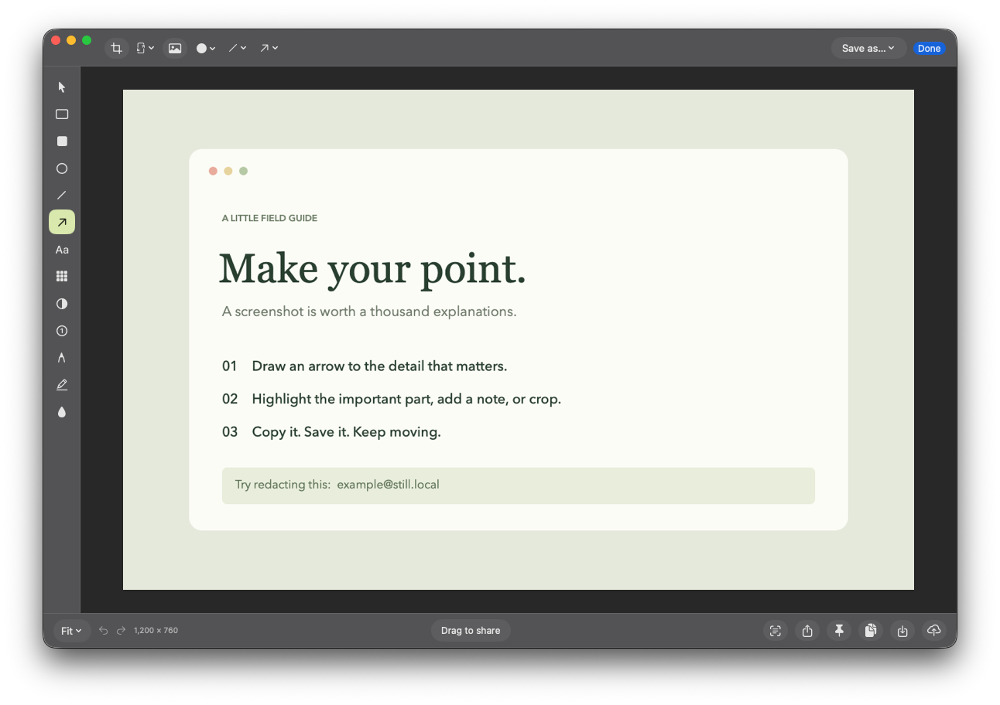
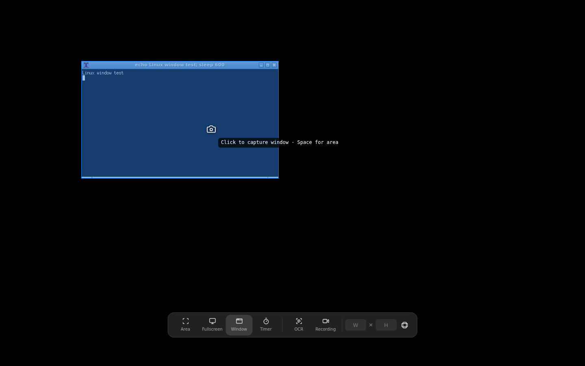

<p align="center">
  
</p>

<p align="center">
  <a href="https://github.com/ImSammyTTV/Still/releases/latest"></a>
  <a href="https://github.com/ImSammyTTV/Still/releases"></a>
  
</p>

<p align="center">
  <b>Still</b> is a screenshot and screen recording app that stays out of your way.<br>
  Press a shortcut, pick an area or a window, mark it up and share it in seconds.
</p>

<p align="center">
  <a href="https://github.com/ImSammyTTV/Still/releases/latest"><b>⬇️ Download</b></a> ·
  <a href="#-quick-start"><b>🚀 Quick start</b></a> ·
  <a href="#️-shortcuts"><b>⌨️ Shortcuts</b></a> ·
  <a href="#-mac"> <b>Mac</b></a> ·
  <a href="#-windows"> <b>Windows</b></a> ·
  <a href="#-linux"> <b>Linux</b></a> ·
  <a href="#-help"><b>❓ Help</b></a> ·
  <a href="https://github.com/ImSammyTTV/Still/issues/new"><b>🐛 Report a bug</b></a>
</p>

---

## ✨ Features

<table>
<tr>
<td width="50%" valign="top">

### 📸 Capture anything
Area, window or full screen from one shortcut. **Hold Space** while selecting to grab a whole window,
just like the built-in Mac screenshot tool. Crosshair, magnifier, exact sizes and aspect-ratio lock included.

</td>
<td width="50%" valign="top">

### ✏️ Annotate in seconds
Arrows, boxes, ellipses, lines, pen, highlighter, text, numbered steps, spotlight, blur, pixelate and redact.
Everything stays editable: move, resize or delete any mark, with full undo.

</td>
</tr>
<tr>
<td valign="top">

### 🖼️ Beautiful backgrounds
Twenty gradients or your own image, with padding, rounded corners, shadows and aspect ratios for
social posts. Make a screenshot presentation-ready in one click.

</td>
<td valign="top">

### ⚡ Quick Access
A floating preview appears after every capture: **Copy**, **Save**, **Annotate**, **Pin** or drag it straight
into Slack, Discord, an email or a document.

</td>
</tr>
<tr>
<td valign="top">

### 🎥 Screen recording
Record an area or the whole screen as MP4 (or GIF on Mac), with microphone and computer audio, a
floating control bar with pause, restart and cancel, and a video editor on Mac.

</td>
<td valign="top">

### 🔤 Copy text from anything
Select text in an image, video or app that won't let you copy, and Still recognises it and puts it on your
clipboard. It runs entirely on your computer.

</td>
</tr>
<tr>
<td valign="top">

### 📌 Pin and history
Pin screenshots above every window while you work, and find any past capture again in **Capture History**,
searchable by title and recognised text.

</td>
<td valign="top">

### 🔒 Private by design
No accounts, no tracking. Captures stay on your computer. Sharing is optional and goes to a server
**you** run (Mac).

</td>
</tr>
</table>

<p align="center">
  
</p>

> [!NOTE]
> **Private by design.** Still has no account and sends nothing anywhere on its own. Text recognition runs
> on your computer, and uploads only happen when you press **Upload** with your own server connected.

---

## 🚀 Quick start

1. **Download** the file for your system from the [latest release](https://github.com/ImSammyTTV/Still/releases/latest):

   | System | Download |
   |---|---|
   | &nbsp;**Mac** | [one-line installer](#-mac) or `Still-…-mac-universal.zip` |
   | &nbsp;**Windows** | `Still_…_x64-setup.exe` (installer) or `Still-…-windows-x64-portable.exe` · ARM: `…_arm64-setup.exe` |
   | &nbsp;**Linux** | see [Linux](#-linux) below |

2. **Open Still.** It lives in your menu bar / system tray and opens its settings the first time.
3. **Mac only:** allow **Screen & System Audio Recording** when asked (the upper list in System Settings).
4. Press **⇧⌘4** on Mac or **Ctrl + Shift + 4** on Windows and Linux, drag over anything, and you're done!

> [!TIP]
> **Windows** may say *"Windows protected your PC"*: click **More info → Run anyway**.
> **Mac:** use the [one-line installer](#-mac) to skip macOS's security prompts.

---

## ⌨️ Shortcuts

| Action | Mac | Windows & Linux |
|---|---|---|
| Capture area (**hold Space** for window) | `⇧⌘4` | `Ctrl + Shift + 4` |
| All-In-One capture bar | `⌃⇧⌘S` | `Ctrl + Shift + 5` |
| Capture window | `⌃⇧⌘4` | `Ctrl + Alt + Shift + 4` |
| Capture full screen | `⌃⇧⌘5` | `Ctrl + Shift + 3` |
| Copy text (OCR) | set in Settings | `Ctrl + Shift + 2` |
| Start / stop recording | `⌃⇧⌘6` | `Ctrl + Shift + 6` |

Every shortcut can be changed in **Settings → Shortcuts**.

**While selecting:** hold `Space` and click to capture a window, let go to go back to area · `Shift` keeps it square · arrow keys nudge
(`Shift` for 10 px, `Alt` / `Option` to resize) · `Enter` captures · `Esc` cancels.
`A` area · `W` window · `F` full screen · `O` text · `V` record · `T` timer.

**In the editor:** `V` select · `A` arrow · `R` rectangle · `O` ellipse · `L` line · `P` pen · `H` highlight ·
`T` text · `N` counter · `B` redact · `U` blur · `X` pixelate · `S` spotlight · `C` crop.

> [!IMPORTANT]
> **Mac:** macOS uses ⇧⌘4 for its own screenshot tool. If Still asks, open **Keyboard Shortcuts → Screenshots**
> and turn off *"Save picture of selected area as a file"*. Still then takes over ⇧⌘4.

---

##  Mac

Open **Terminal** (press ⌘ Space, type *Terminal*, press Enter), paste this and press Enter:

```sh
curl -fsSL https://raw.githubusercontent.com/ImSammyTTV/Still/main/install-mac.sh | sh
```

It downloads the latest release, checks it against the release's checksum, installs **Still.app** into
Applications and opens it. Works on Apple silicon and Intel Macs running **macOS 15 or later**.

The Mac version is a native Swift app and has extras: scrolling capture, a full **video editor** (trim, zooms,
cursor effects, camera bubble, GIF export), click and keystroke overlays, audio transcription, and optional
sharing to your own server.

<details>
<summary>Installing from the zip instead</summary>

Still isn't notarized by Apple yet, so macOS blocks it the first time:

1. Unzip, move **Still.app** to Applications and double-click it. macOS says it can't be opened: click **Done**.
2. Open **System Settings → Privacy & Security**, scroll down and click **Open Anyway** next to Still.
3. Confirm with your password. From then on it opens normally.
</details>

<details>
<summary>Screen capture isn't working</summary>

Open **System Settings → Privacy & Security → Screen & System Audio Recording** and make sure Still is switched on
in the **upper** list. The lower *System Audio Recording Only* list doesn't allow screenshots. If Still isn't there,
click **+**, choose `/Applications/Still.app`, switch it on and reopen Still.
</details>

Uninstall: quit Still and drag it from Applications to the Bin. Your captures are in
`~/Library/Application Support/Still`.

---

##  Windows

Download `Still_…_x64-setup.exe` from the [latest release](https://github.com/ImSammyTTV/Still/releases/latest) and run it
(use `…_arm64-setup.exe` on Snapdragon / ARM PCs). Prefer no installer? Run `Still-…-windows-x64-portable.exe` directly.
It's a small download (about 10 MB) because Still uses the Edge WebView2 engine that's already part of Windows 10 and 11.

- Still sits in the **system tray**. Click the icon for a quick capture, or right-click for the full menu.
- **Updates install themselves**: Still checks in the background and offers **Update** in the tray menu.
- **Recording:** choose an area, then pick the screen in Windows' share dialog. Computer audio can be recorded
  alongside your microphone (Settings → Recording), and the recording controls are hidden from your recordings.
- Switch on **Launch at login** in Settings → General.

---

##  Linux

Install a package from the [latest release](https://github.com/ImSammyTTV/Still/releases/latest):

| Distro | Package |
|---|---|
| Any distro | `.AppImage` (make it executable and run it; updates itself) |
| Ubuntu, Debian, Mint, Pop!_OS | `.deb` |
| Fedora, openSUSE, Nobara | `.rpm` |

Still needs a 2024-or-newer distro (for example Ubuntu 24.04, Fedora 40, Debian 13) with WebKitGTK 4.1, which the
packages install for you. Screen recording depends on your desktop's screen sharing support in WebKitGTK; if it isn't
available, Still tells you instead of failing silently.

<p align="center">
  
</p>

> [!WARNING]
> **Wayland:** screenshots work through your desktop's screen-sharing prompt, but picking a single window by holding
> **Space** needs an **X11** session, and some desktops don't let apps register global shortcuts. Add a custom
> keyboard shortcut in your desktop settings that runs `still --capture=area` (or `fullscreen`, `window`,
> `record`, `text`, `allInOne`, `history`).

---

## ❓ Help

<details>
<summary><b>My shortcut doesn't do anything</b></summary>

Another app may already use it. Still marks taken shortcuts in red under **Settings → Shortcuts**: click it and
press a different combination. On Mac, check that the macOS ⇧⌘4 screenshot shortcut is turned off (see
[Shortcuts](#️-shortcuts)).
</details>

<details>
<summary><b>Is blur safe for hiding passwords?</b></summary>

Use **Redact** (`B`) for anything sensitive: it paints solid black over the pixels in the saved image. Blur and
pixelate are for looks and can sometimes be reversed. Share the exported image, not the editable project.
</details>

<details>
<summary><b>Where are my captures and settings?</b></summary>

| System | Folder |
|---|---|
| Mac | `~/Library/Application Support/Still` |
| Windows | `%AppData%\Still` |
| Linux | `~/.config/Still` |

Every capture keeps its original, so you can reopen it from **Capture History** and change your annotations later.
**Save** puts a copy in your export folder (Desktop by default, change it in Settings → General).
</details>

<details>
<summary><b>Text recognition copied the wrong thing</b></summary>

Select just the text, with a little space around it. Larger, clearer text gives the best results. Recognition is
in English on Windows and Linux and uses your Mac's languages on macOS.
</details>

🐛 **Found a bug or have an idea?** [Open an issue](https://github.com/ImSammyTTV/Still/issues/new). Say what you expected and
what happened instead, and which system you're on. Ideas and "it'd be nice if…" suggestions are welcome too.

---

## 🛠️ For developers

<details>
<summary><b>Project layout</b></summary>

| Folder | What's in it |
|---|---|
| `Sources/`, `Tests/` | The native Mac app (Swift, AppKit, SwiftUI, ScreenCaptureKit, Vision, AVFoundation) |
| `Desktop/` | The Windows and Linux app (Tauri: Rust in `src-tauri/`, pages in `web/`) |
| `Cloud/` | The optional self-hosted sharing server (Python, standard library only) — see [Cloud/README.md](Cloud/README.md) |
| `FEATURES.md` | Detailed feature coverage and what still needs live testing |
</details>

<details>
<summary><b>Building the Mac app</b></summary>

Requires Xcode 16 or later.

```sh
swift test
./scripts/build.sh            # universal Still.app next to the project folder
```

The build script signs with your Apple Development identity if you have one (so Screen Recording permission
survives rebuilds), otherwise ad-hoc.
</details>

<details>
<summary><b>Building the Windows and Linux app</b></summary>

Requires Node.js 20+ and Rust (`rustup`). On Linux also install the WebKitGTK and PipeWire development packages
listed in [`.github/workflows/release.yml`](.github/workflows/release.yml).

```sh
cd Desktop
npm install
npm test                      # JavaScript and Rust tests
npm start                     # run from source
npm run demo                  # open the editor with a sample image
npm run build                 # installers in Desktop/src-tauri/target/release/bundle
```

`still --self-test=<folder>` runs a capture, Quick Access, copy, editor and text-recognition check and writes
`results.json`; CI runs it on real Windows and Linux machines.
</details>

<details>
<summary><b>Running the sharing server</b></summary>

```sh
python3 -m unittest discover -s Cloud/tests -v
python3 Cloud/server.py --data ./data --host 127.0.0.1 --port 7843
```
</details>

<details>
<summary><b>Releasing (maintainers)</b></summary>

Go to **Actions → Release → Run workflow** and enter the version (e.g. `v1.0.0`). GitHub Actions builds the Mac,
Windows and Linux downloads, writes checksums and publishes the release.
</details>

---

<p align="center">
  Made with 💚 by <a href="https://github.com/ImSammyTTV">ImSammyTTV</a> · <a href="FEATURES.md">Feature details</a>
</p>
