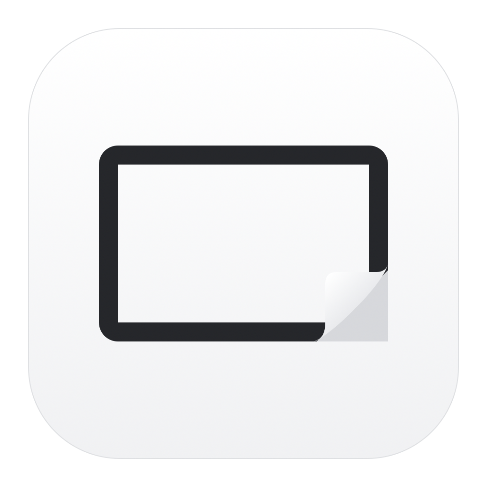
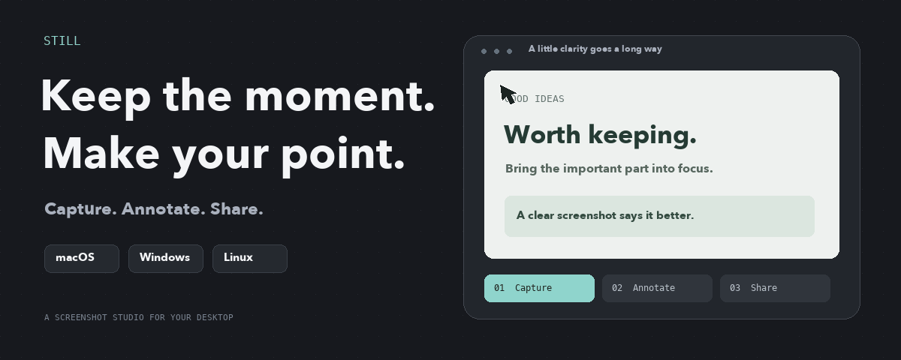

<p align="center">
  
</p>

<h1 align="center">Still</h1>
<p align="center"><strong>A screenshot is only the beginning.</strong><br>Capture a moment, make your point, and keep moving.</p>

<p align="center">
  <a href="https://github.com/ImSammyTTV/Still/releases/latest"></a>
  <a href="https://github.com/ImSammyTTV/Still/actions/workflows/ci.yml"></a>
  
</p>

<p align="center">
  <a href="#download">Download</a> · <a href="#why-still">Features</a> · <a href="#getting-started">Getting started</a> · <a href="#shortcuts">Shortcuts</a> · <a href="#sharing">Sharing</a> · <a href="#development">Development</a>
</p>

<picture>
  <source media="(prefers-reduced-motion: reduce)" srcset="assets/readme/capture-workflow.png">
  
</picture>

Still lives in your menu bar or system tray. Capture an area, a window, or a whole screen; add clear annotations; copy, save, pin, or share the result. The Mac app is native Swift. Windows and Linux use a lightweight Tauri app.

<a id="download"></a>
## Download

**[Get the latest release →](https://github.com/ImSammyTTV/Still/releases/latest)**

| Platform | Choose this download | Architecture |
| :--- | :--- | :--- |
| **macOS 15+** | `Still-…-mac-universal.zip` | Apple silicon + Intel in one app |
| **Windows** | `Still_…_x64-setup.exe` or `Still_…_arm64-setup.exe` | x64 / ARM64 |
| **Linux** | `.AppImage`, `.deb`, or `.rpm` | x64 / ARM64 |

Windows portable executables are included too. Each release includes `SHA256SUMS`; update packages also carry the project's update signatures.

<a id="why-still"></a>
## Small tool. Useful details.

| Capture | Make it clear | Keep it moving |
| :--- | :--- | :--- |
| Areas, windows, and whole screens | Arrows, text, shapes, and numbered steps | Automatic clipboard copy |
| Timers and exact dimensions | Highlighter, spotlight, and solid redaction | A floating preview with quick actions |
| Text recognition on your computer | Backgrounds, padding, corners, and shadows | Pin captures and reopen history |
| Screen recording | Editable annotations and undo | Upload to your own Still Cloud server |

**More on Mac:** scrolling capture, clipboard history, video editing, GIF export, camera overlays, cursor effects, QR recognition, and image Services in Finder.

> [!NOTE]
> Platform support varies. [FEATURES.md](FEATURES.md) separates implemented features from those checked by tests or hands-on use. Windows/Linux recording depends on the system's screen-sharing support; hover-based window selection requires Windows or Linux X11.

<a id="getting-started"></a>
## Your first capture

1. **Install and open Still.** The setup assistant walks you through the essentials.
2. **Allow screen capture when asked.** Camera, microphone, and cloud setup are optional.
3. **Choose Capture Area** from the menu bar or tray, then drag. Hold **Space** to select a window; **Escape** cancels selection.
4. **Paste or edit.** The capture is copied to your clipboard. Use the floating preview to annotate, save, pin, or upload it.

Save actions use **Documents/Still** unless you choose another export folder in Settings. Capture History keeps the app's editable originals separately.

<details>
<summary><strong>Installing on Mac</strong></summary>

Extract the universal ZIP, move **Still.app** to **Applications**, and open it. Still appears in the menu bar rather than the Dock.

Still uses the project's own signing certificate and is not notarized by Apple. If macOS blocks the first launch, review its notice under **System Settings → Privacy & Security** before opening the app.

The repository also includes an installer that verifies the release checksums and Still's signing identity:

```sh
curl -fsSL https://raw.githubusercontent.com/ImSammyTTV/Still/main/install-mac.sh -o install-still.sh
less install-still.sh
sh install-still.sh
```

For screen access, enable **Still** in the upper **Screen & System Audio Recording** list. The **System Audio Recording Only** list does not permit screenshots. You can reopen the guide from **Settings → General → Open Setup Assistant**.

</details>

<details>
<summary><strong>Installing on Windows</strong></summary>

Choose the **x64** installer for most PCs, or **ARM64** for an ARM-based PC. Portable executables are available if you prefer not to run an installer. Still uses the system's Edge WebView2 engine.

Windows downloads are not yet signed with a Windows publisher certificate. Review the release source and checksums if Windows displays a first-launch warning.

</details>

<details>
<summary><strong>Installing on Linux</strong></summary>

- **AppImage:** make the downloaded file executable, then run it.
- **Debian / Ubuntu:** install the `.deb` package.
- **Fedora / other RPM distributions:** install the `.rpm` package.

Linux builds use Ubuntu 24.04 and need compatible WebKitGTK and desktop screen-sharing libraries. Wayland uses your desktop's sharing portal. If global shortcuts are restricted, bind a desktop shortcut to `still --capture=area`. Other actions include `window`, `fullscreen`, `text`, `record`, `allInOne`, and `history`. For an image file, `still --open=FILE` opens it in the editor, `--text=FILE` copies its text and `--pin=FILE` pins it; the Windows installer adds these to the right-click menu of PNG and JPEG files, and on Linux Still is listed under Open With.

</details>

<a id="shortcuts"></a>
## A few keys to remember

| Action | Mac | Windows / Linux |
| :--- | :--- | :--- |
| Capture an area | `⇧⌘4` | `Ctrl Shift 4` |
| Capture Bar | `⌃⇧⌘S` | `Ctrl Shift 5` |
| Capture a window | `⌃⇧⌘4` | `Ctrl Alt Shift 4` |
| Whole screen | `⌃⇧⌘5` | `Ctrl Shift 3` |
| Start / stop recording | `⌃⇧⌘6` | `Ctrl Shift 6` |
| Clipboard history | `⇧⌘V` | — |

**While selecting:** hold **Space** for a window, press **Enter** to confirm an area, or **Escape** to cancel. Arrow keys nudge; **Shift** makes larger nudges. Scroll to zoom the magnifier in or out. Shortcuts can be changed in **Settings → Shortcuts**.

macOS reserves `⇧⌘4` for its screenshot tool. To use it with Still, turn off the matching selected-area shortcut in **Keyboard → Keyboard Shortcuts → Screenshots**, or choose a different shortcut in Still.

<a id="sharing"></a>
## Your captures. Your server.

Screenshots and text recognition stay on your computer unless you upload them. Still Cloud is an optional server you run yourself, with share links, comments, passwords, expiry, and team access.

You can also send uploads to **Google Drive**: connect it in **Settings → Cloud**, and captures go into a Still folder in your Drive with the link copied for you. Still can only see the files it put there.

On Mac and Windows you can pick **iCloud Drive** instead. Upload then saves into a Still folder that syncs to your devices. iCloud has no share links, so there’s nothing to copy.

[Set up Still Cloud →](Cloud/README.md)

Connect it in **Settings → Cloud**, then choose **Upload**. Uploads include recognised text and any recording transcript so your server can search them. Auto-upload is a separate opt-in setting.

<a id="help"></a>
## Need a hand?

<details>
<summary><strong>Screen access is enabled, but capture still fails</strong></summary>

Keep a single copy of Still in Applications, reopen it, and run the check in the setup assistant. macOS associates access with the app's signing identity: a differently signed development build can appear enabled while capture is denied. Release updates retain the same signing identity.

</details>

<details>
<summary><strong>Can I safely hide private information with blur?</strong></summary>

Use **Redact** for private information. It replaces the covered pixels in the exported image. Blur and pixelation are visual effects. Editable projects retain the original image, so share a flattened image export rather than the project file when redacting.

</details>

<details>
<summary><strong>Where are the editable originals?</strong></summary>

| System | App data |
| :--- | :--- |
| Mac | `~/Library/Application Support/Still` |
| Windows | `%AppData%\app.still.desktop` |
| Linux | `~/.local/share/app.still.desktop` and `~/.config/app.still.desktop` |

These folders are separate from **Documents/Still**, the default export location. Updating the app preserves your capture library.

</details>

**[Report a bug](https://github.com/ImSammyTTV/Still/issues/new)** with your system, what you expected, and what happened. For updates, use **Check for Updates** in the menu bar or **Settings → About** on Windows/Linux.

<a id="development"></a>
## Build and contribute

<details>
<summary><strong>Native Mac app</strong></summary>

Requires Xcode with the macOS 15+ SDK.

```sh
swift test
./scripts/build.sh
```

Keep development builds separate from the installed release. Changing the signing identity can invalidate existing screen permissions. Maintainers can use the **Mac Preview** workflow and `scripts/install-mac.sh` to preserve the release identity.

</details>

<details>
<summary><strong>Windows and Linux app</strong></summary>

Requires Node.js 20+, Rust, and the platform dependencies listed in [the release workflow](.github/workflows/release.yml).

```sh
cd Desktop
npm ci
npm test
npm start
npm run build
```

The app uses Tauri with shared web views. CI also runs `still --self-test=<folder>` on Windows and Linux.

The shared look is documented in [docs/DESIGN-SYSTEM.md](docs/DESIGN-SYSTEM.md) and the brand in [docs/BRAND.md](docs/BRAND.md). `npm test` includes a guard that keeps page styles on the design tokens.

</details>

<details>
<summary><strong>Sharing server and releases</strong></summary>

The server uses Python's standard library:

```sh
python3 -m unittest discover -s Cloud/tests -v
```

Maintainers publish through **Actions → Release → Run workflow** with a version such as `v1.2.7`. Every platform must finish before the workflow publishes downloads, update signatures, checksums, and the updater feed.

README motion artwork is generated by `scripts/readme-artwork.py` with Pillow. The animation plays once, then rests; reduced-motion viewers receive a static image.

</details>

No project license has been added yet.

---

<p align="center">Made by <a href="https://github.com/ImSammyTTV">ImSammyTTV</a> · <a href="FEATURES.md">Feature status</a> · <a href="https://github.com/ImSammyTTV/Still/releases">Release history</a></p>
