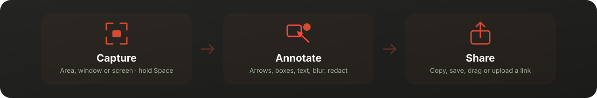

<p align="center">
  
</p>

<p align="center">
  <a href="https://github.com/ImSammyTTV/Still/releases/latest"></a>
  <a href="https://github.com/ImSammyTTV/Still/releases"></a>
  
</p>

<h3 align="center">A calm, fast screenshot tool that stays out of your way.</h3>

<p align="center">
  Press a shortcut, grab an area or a window, mark it up and send it, usually in under five seconds.<br>
  Free, private and made for macOS, Windows and Linux.
</p>

<p align="center">
  <a href="#-get-still">Get Still</a> ·
  <a href="#-what-it-does">What it does</a> ·
  <a href="#️-shortcuts">Shortcuts</a> ·
  <a href="#-sharing-links">Sharing</a> ·
  <a href="#-help">Help</a> ·
  <a href="https://github.com/ImSammyTTV/Still/issues/new">Report a bug</a>
</p>

<br>

<p align="center">
  
</p>

## 📥 Get Still

<p align="center">
  <a href="#-macos"></a>
  <a href="#-windows"></a>
  <a href="#-linux"></a>
</p>

Still opens a short setup guide on first launch. Start with screen capture; camera, microphone and cloud are optional. You can reopen the guide from Settings at any time.

###  macOS

Paste this into **Terminal** (⌘ Space, type *Terminal*, press Enter):

```sh
curl -fsSL https://raw.githubusercontent.com/ImSammyTTV/Still/main/install-mac.sh | sh
```

It downloads the latest release, checks it against the release's checksums, installs **Still.app** into Applications
and opens it. Works on Apple silicon and Intel Macs running macOS 15 or later.

The first time you capture, allow Still under **System Settings → Privacy & Security → Screen & System Audio Recording**
(the **upper** list). Still lives in your menu bar, not the Dock.

<details>
<summary>Installing from the zip instead</summary>

1. Download `Still-…-mac-universal.zip` from the [latest release](https://github.com/ImSammyTTV/Still/releases/latest), unzip it and move **Still.app** to Applications.
2. Double-click it. macOS says it can't check it: click **Done**.
3. Open **System Settings → Privacy & Security**, scroll down and click **Open Anyway**. From then on it opens normally.
</details>

###  Windows

Download **`Still_…_x64-setup.exe`** from the [latest release](https://github.com/ImSammyTTV/Still/releases/latest) and run it.
On Snapdragon and other ARM PCs, use `…_arm64-setup.exe`. Prefer no installer? Run `Still-…-windows-x64-portable.exe`.

It's about 9 MB, because Still uses the Edge WebView2 engine that's already part of Windows 10 and 11.
If Windows says *"Windows protected your PC"*, click **More info → Run anyway**.

###  Linux

| Distro | Download |
|---|---|
| Any distro | `.AppImage`: make it executable and run it |
| Ubuntu, Debian, Mint, Pop!_OS | `.deb` |
| Fedora, openSUSE, Nobara | `.rpm` |

Needs a 2024-or-newer distro (Ubuntu 24.04, Fedora 40, Debian 13). Picking a single window with **Space** needs an X11
session; on Wayland, Still captures through your desktop's screen sharing prompt. If your desktop won't let apps set
global shortcuts, add your own shortcut that runs `still --capture=area`
(or `window`, `fullscreen`, `text`, `record`, `allInOne`, `history`).

> [!TIP]
> **Updates install themselves.** On Windows and Linux, Still offers new versions in a small card in the corner and in
> **Settings → About**. On Mac, use **Check for Updates…** in the menu bar menu.

## ✨ What it does

<table>
<tr>
<td width="50%" valign="top">

#### 📸 Capture anything
Drag over an area, or **hold Space** and click a window. Full screen, timed captures, exact sizes and aspect-ratio lock
are in the **Capture Bar** at the bottom of the screen. Open menus and Spotlight stay in the shot.

</td>
<td width="50%" valign="top">

#### 🪟 Floating Preview
Every capture lands in a small preview in the corner, already copied to your clipboard. Copy, save, edit, pin or upload
from its action bar, or drag it straight into Slack, Discord, an email or a document.

</td>
</tr>
<tr>
<td valign="top">

#### ✏️ Annotate
Arrows, boxes, ellipses, lines, pen, highlighter, text, numbered steps, spotlight, blur, pixelate and solid redaction,
all in a tool rail down the side. Every mark stays editable, with full undo.

</td>
<td valign="top">

#### 🖼️ Make it presentable
Gradient or image backgrounds, padding, rounded corners, shadows and aspect ratios for social posts,
then **Drag to share** or save.

</td>
</tr>
<tr>
<td valign="top">

#### 🔤 Copy text from anything
Select text in an image, a video or an app that won't let you copy, and Still puts it on your clipboard.
Recognition runs on your computer.

</td>
<td valign="top">

#### 🎥 Record your screen
Record an area or the whole screen with your microphone and computer audio (Mac and Windows). On Mac there's also GIF export,
a camera bubble, click and keystroke overlays, and a video editor.

</td>
</tr>
<tr>
<td valign="top">

#### 📌 Pin and find again
Pin a capture above every window while you work, and find anything again in **Capture History**,
searchable by title and recognised text.

</td>
<td valign="top">

#### 🔒 Private by design
No account and no tracking. Captures stay on your computer, and sharing only happens when you press **Upload**
with your own server connected.

</td>
</tr>
<tr>
<td valign="top">

#### 📋 Clipboard history (Mac)
Press `⇧⌘V` for everything you've copied lately: text, images and files. Pick one to put it back on your clipboard.
Anything a password manager marks as private is skipped.

</td>
<td valign="top">

#### 🌊 Lives in your menu bar
No Dock icon and no window to manage. Still waits quietly in the menu bar or tray until you press a shortcut.

</td>
</tr>
</table>

<p align="center">
  
</p>

## ⌨️ Shortcuts

| Action | Mac | Windows & Linux |
|---|---|---|
| Capture an area (**hold Space** for a window) | `⇧⌘4` | `Ctrl + Shift + 4` |
| Open the Capture Bar | `⌃⇧⌘S` | `Ctrl + Shift + 5` |
| Capture a window | `⌃⇧⌘4` | `Ctrl + Alt + Shift + 4` |
| Capture the whole screen | `⌃⇧⌘5` | `Ctrl + Shift + 3` |
| Copy text from the screen | set it in Settings | `Ctrl + Shift + 2` |
| Start or stop recording | `⌃⇧⌘6` | `Ctrl + Shift + 6` |
| Clipboard history | `⇧⌘V` | — |

Change any of them in **Settings → Shortcuts**.

**While selecting:** hold `Space` over a window and click to capture it · `Shift` keeps it square · arrow keys nudge
(`Shift` for 10 px, `Alt` / `Option` to resize) · `Enter` captures · `Esc` cancels.

**In the editor:** `V` select · `A` arrow · `R` rectangle · `O` ellipse · `L` line · `P` pen · `H` highlight ·
`T` text · `N` counter · `B` redact · `U` blur · `X` pixelate · `S` spotlight · `C` crop.

> [!IMPORTANT]
> **Mac:** macOS uses ⇧⌘4 for its own screenshot tool. If Still asks, open **Keyboard Shortcuts → Screenshots** and
> turn off *"Save picture of selected area as a file"*.

## 🔗 Sharing links

Run your own **Still Cloud** server (it's in [`Cloud/`](Cloud/README.md): one Python file, no dependencies), then
connect to it in **Settings → Cloud** on any platform. Press **Upload** in the Floating Preview, the editor or Capture
History, and the share link is copied for you. Links can expire, be limited to your team, or be private, and the server
has a viewer with comments.

## ❓ Help

<details>
<summary><b>Screen capture doesn't work on my Mac</b></summary>

Open **System Settings → Privacy & Security → Screen & System Audio Recording** and make sure Still is switched on in the
**upper** list. The lower *System Audio Recording Only* list doesn't allow screenshots. If Still isn't listed, click **+**,
choose `/Applications/Still.app`, switch it on and reopen Still.

If the switch is already on, open **Settings → General → Open Setup Assistant** and use **Check Again**. A developer build signed with a different certificate can appear enabled while macOS rejects it. Install a build signed with the same release identity before changing permissions. Keep one copy of Still in Applications.
</details>

<details>
<summary><b>My shortcut doesn't do anything</b></summary>

Another app may already use it. Still marks taken shortcuts in red under **Settings → Shortcuts**: click one and press a new
combination. On Mac, also check the ⇧⌘4 note under [Shortcuts](#️-shortcuts).
</details>

<details>
<summary><b>Is blur safe for hiding passwords?</b></summary>

Use **Redact** (`B`): it paints solid black over the pixels in the saved image. Blur and pixelate are for looks and can
sometimes be reversed. Share the exported image, not the editable project.
</details>

<details>
<summary><b>Where are my captures and settings?</b></summary>

| System | Folder |
|---|---|
| Mac | `~/Library/Application Support/Still` |
| Windows | `%AppData%\app.still.desktop` |
| Linux | `~/.local/share/app.still.desktop` (captures) and `~/.config/app.still.desktop` (settings) |

Every capture keeps its original, so you can reopen it from **Capture History** and change your annotations later.
**Save** puts a copy in your export folder (the Desktop unless you choose another in Settings).
</details>

Found a bug or have an idea? [Open an issue](https://github.com/ImSammyTTV/Still/issues/new) and say what you expected,
what happened instead, and which system you're on.

## 🛠️ For developers

<details>
<summary><b>Project layout</b></summary>

| Folder | What's in it |
|---|---|
| `Sources/`, `Tests/` | The Mac app (Swift, AppKit, SwiftUI, ScreenCaptureKit, Vision, AVFoundation) |
| `Desktop/` | The Windows and Linux app (Tauri: Rust in `src-tauri/`, pages in `web/`) |
| `Cloud/` | The optional self-hosted sharing server (Python standard library only) |
| `FEATURES.md` | What's built on each platform and what's still to do |
</details>

<details>
<summary><b>Building</b></summary>

**Mac** (Xcode 16 or later):

```sh
swift test
./scripts/build.sh            # universal Still.app next to the project folder
```

**Windows and Linux** (Node.js 20+ and Rust; Linux also needs the WebKitGTK and PipeWire development packages listed in
[`release.yml`](.github/workflows/release.yml)):

```sh
cd Desktop
npm install
npm test                      # JavaScript and Rust tests
npm start                     # run from source
npm run build                 # installers in src-tauri/target/release/bundle
```

`still --self-test=<folder>` checks capture, the Floating Preview, copying, the editor, text recognition and sharing, and
writes `results.json`. CI runs it on real Windows and Linux machines.

**Sharing server:** `python3 -m unittest discover -s Cloud/tests -v`
</details>

<details>
<summary><b>Releasing</b></summary>

Run **Actions → Release → Run workflow** with a version such as `v1.2.0`. GitHub Actions builds the Mac, Windows and Linux
downloads, signs the update files, writes checksums and publishes the release.
</details>

<details>
<summary><b>Code signing</b></summary>

- **Mac** releases are signed with the project's own certificate, so macOS treats each update as the same app and keeps
  its Screen Recording permission. They aren't notarized by Apple, which is why the first launch needs **Open Anyway**
  (the Terminal installer skips that).
- **Windows** downloads aren't code-signed yet, so Windows may show a SmartScreen warning the first time.
- **Updates** on Windows and Linux are verified against the project's update signing key before they install.
- Still doesn't collect any data. It only contacts GitHub to check for updates and, if you set one up, your own Still
  Cloud server when you upload.
</details>

<br>

<p align="center">
  Made by <a href="https://github.com/ImSammyTTV">ImSammyTTV</a> · <a href="FEATURES.md">Feature list</a> · <a href="https://github.com/ImSammyTTV/Still/releases">Releases</a>
</p>
