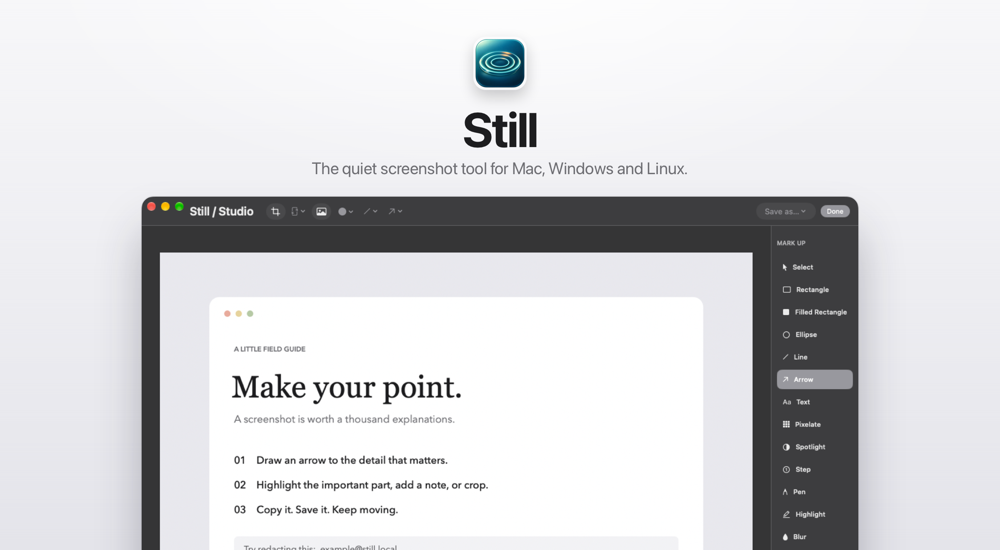

<p align="center">
  <picture>
    <source media="(prefers-color-scheme: dark)" srcset="assets/hero-dark.png">
    
  </picture>
</p>

<p align="center">
  <a href="#macos"></a>
  <a href="#windows"></a>
  <a href="#linux"></a>
</p>

<p align="center">
  <sub>Free · No account · Captures stay on your computer</sub>
</p>

<br>

Press a shortcut, drag over anything, and the capture is already on your clipboard. Mark it up, share it, or just
paste it. Still waits quietly in your menu bar until you need it.

<br>

## What it does

<table>
<tr>
<td width="33%" valign="top">
<br>
<b>Capture</b><br>
Drag over an area, or hold <kbd>Space</kbd> and click a window. Menus and Spotlight stay in the shot.
</td>
<td width="33%" valign="top">
<br>
<b>Floating Preview</b><br>
Every capture waits in the corner, already copied. Save, edit, pin, upload or drag it anywhere.
</td>
<td width="33%" valign="top">
<br>
<b>Mark up</b><br>
Arrows, steps, highlights, blur and solid redaction. Every mark stays editable.
</td>
</tr>
<tr>
<td valign="top">
<br>
<b>Copy text</b><br>
Select text in any image or video. It's read on your computer, not in the cloud.
</td>
<td valign="top">
<br>
<b>Record</b><br>
An area or the whole screen, with audio. On Mac: GIF export, camera bubble and a video editor.
</td>
<td valign="top">
<br>
<b>Clipboard history</b> <sub>Mac</sub><br>
<kbd>⇧</kbd><kbd>⌘</kbd><kbd>V</kbd> brings back text, images and files. Private items are skipped.
</td>
</tr>
</table>

<br>

## Install

### macOS

Paste this into **Terminal** (<kbd>⌘</kbd> <kbd>Space</kbd>, type *Terminal*):

```sh
curl -fsSL https://raw.githubusercontent.com/ImSammyTTV/Still/main/install-mac.sh | sh
```

It downloads the latest release, checks it against its checksum **and** the project's signature, and opens Still.
Apple silicon and Intel, macOS 15 or later. The first time you capture, switch Still on under
**System Settings → Privacy & Security → Screen & System Audio Recording**.

<details>
<summary>Prefer the zip?</summary>

Download `Still-…-mac-universal.zip` from the [latest release](https://github.com/ImSammyTTV/Still/releases/latest),
unzip it and move **Still.app** to Applications. Still isn't notarized by Apple, so the first launch needs
**System Settings → Privacy & Security → Open Anyway**.
</details>

### Windows

Download **`Still_…_x64-setup.exe`** from the [latest release](https://github.com/ImSammyTTV/Still/releases/latest)
and run it (`…_arm64-setup.exe` on ARM PCs, or the `portable.exe` if you'd rather not install). About 9 MB.
If Windows says *"Windows protected your PC"*, choose **More info → Run anyway**.

### Linux

Grab the `.AppImage` (any distro), `.deb` (Ubuntu, Debian, Mint) or `.rpm` (Fedora, openSUSE) from the
[latest release](https://github.com/ImSammyTTV/Still/releases/latest). Needs Ubuntu 24.04, Fedora 40, Debian 13 or newer.
Picking a window with <kbd>Space</kbd> needs X11; on Wayland Still uses your desktop's screen-sharing prompt.

Updates install themselves from a small card in the corner. On Mac you can also choose **Check for Updates…** in the menu bar.

<br>

## Shortcuts

| | Mac | Windows & Linux |
|---|---|---|
| Capture an area (hold <kbd>Space</kbd> for a window) | `⇧⌘4` | `Ctrl Shift 4` |
| Capture Bar | `⌃⇧⌘S` | `Ctrl Shift 5` |
| Capture the whole screen | `⌃⇧⌘5` | `Ctrl Shift 3` |
| Copy text from the screen | set in Settings | `Ctrl Shift 2` |
| Record the screen | `⌃⇧⌘6` | `Ctrl Shift 6` |
| Clipboard history | `⇧⌘V` | n/a |

Change any of them in **Settings → Shortcuts**. macOS uses `⇧⌘4` for its own screenshots, so if Still asks, turn off
*"Save picture of selected area as a file"* under **System Settings → Keyboard → Keyboard Shortcuts → Screenshots**.

<br>

## Share a link

Run your own **Still Cloud** server (one Python file in [`Cloud/`](Cloud/README.md), no dependencies) and connect it
in **Settings → Cloud**. **Upload** copies a link that can expire, stay within your team or be private. Uploads also
include any text Still read from the capture, so your server can search it.

<br>

## Help

<details>
<summary>Screen capture doesn't work on my Mac</summary>

Open **System Settings → Privacy & Security → Screen & System Audio Recording** and make sure Still is on in the
**upper** list. If it's missing, click **+**, choose `/Applications/Still.app` and reopen Still. Still stuck?
**Settings → General → Open Setup Assistant → Check Again**, and keep only one copy of Still in Applications.
</details>

<details>
<summary>A shortcut doesn't do anything</summary>

Another app may already use it. Still marks taken shortcuts in red under **Settings → Shortcuts**: click one and press
a new combination.
</details>

<details>
<summary>Is blur safe for hiding passwords?</summary>

Use **Redact**, which paints solid colour over the pixels. Blur and pixelate are for looks and can sometimes be
reversed. Share the exported image, not the editable project.
</details>

<details>
<summary>Where are my captures?</summary>

Saves go to **Documents › Still** unless you pick another folder in Settings. Every capture also keeps its original in
Capture History, so you can reopen and change it later: `~/Library/Application Support/Still` on Mac,
`%AppData%\app.still.desktop` on Windows, `~/.local/share/app.still.desktop` on Linux.
</details>

<details>
<summary>How are downloads signed?</summary>

Mac releases use the project's own certificate, so macOS keeps Screen Recording permission across updates; the updater
and installer refuse anything signed differently. They aren't notarized by Apple, which is why the zip needs **Open
Anyway**. Windows downloads aren't code-signed yet, so SmartScreen may warn the first time. Windows and Linux updates
are verified against the project's update key. Still only contacts GitHub to check for updates, and your own server if
you upload.
</details>

Found a bug or have an idea? [Open an issue](https://github.com/ImSammyTTV/Still/issues/new) and say which system
you're on.

<br>

## Building Still

<details>
<summary>From source</summary>

**Mac** (Xcode 16+): `swift test` then `./scripts/build.sh`.

**Windows and Linux** (Node.js 20+, Rust; Linux also needs the WebKitGTK and PipeWire packages listed in
[`release.yml`](.github/workflows/release.yml)):

```sh
cd Desktop
npm install
npm test          # JavaScript and Rust tests
npm start         # run from source
npm run build     # installers in src-tauri/target/release/bundle
```

`still --self-test=<folder>` checks capture, the preview, copying, the editor, text recognition and sharing; CI runs it
on real Windows and Linux machines. Server tests: `python3 -m unittest discover -s Cloud/tests -v`.
</details>

<details>
<summary>Releasing</summary>

**Actions → Release → Run workflow** with a version such as `v1.3.0` builds every download, signs the updates, writes
checksums and publishes the release. It stops if a platform is missing or the Mac app isn't signed with the project's
certificate.
</details>

<br>

<p align="center">
  <sub>Made by <a href="https://github.com/ImSammyTTV">ImSammyTTV</a> · <a href="FEATURES.md">What's built on each platform</a> · <a href="https://github.com/ImSammyTTV/Still/releases">Releases</a></sub>
</p>
